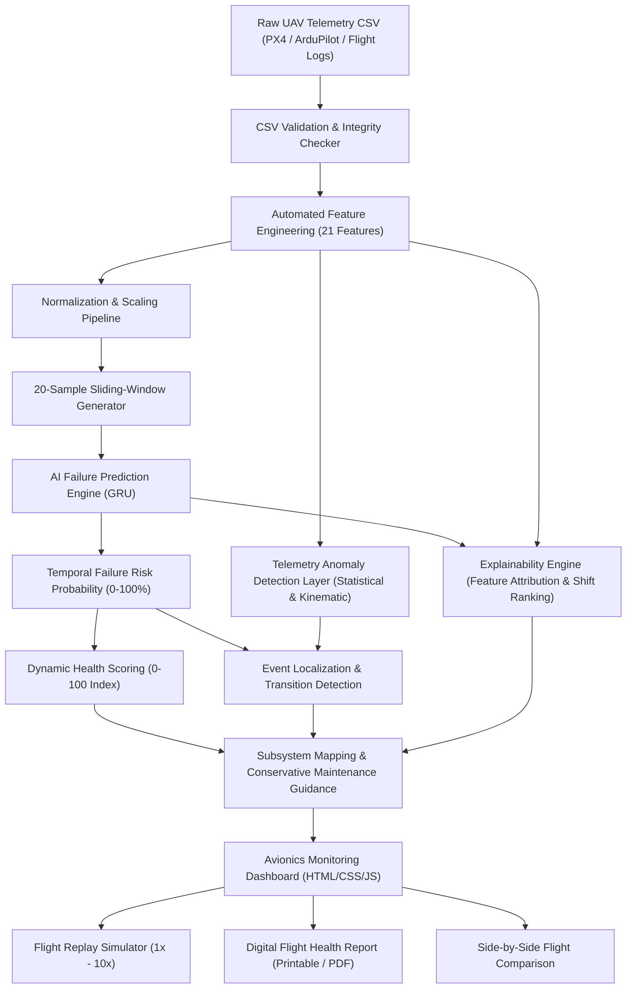

# AeroVigil: UAV Engine Health, Failure Prediction, and Early Warning Platform

[](#software-architecture)
[](#ai--ml-engine)
[](#dashboard-interface)
[](#honest-technical-claims)

> **"A software-only UAV engine health and early-warning platform that converts flight telemetry into an interpretable, time-dependent engine-risk assessment."**

---

## 1. Executive Summary

Modern uncrewed aerial vehicles (UAVs) depend on multi-rotor brushless DC (BLDC) motors, electronic speed controllers (ESCs), and rotor assemblies operating in dynamic aeromechanical regimes. Physical component failures (bearing spalling, stator winding phase desynchronization, rotor blade delamination, thermal throttling) frequently manifest in telemetry signals **well before catastrophic loss of vehicle**.

**AeroVigil** is a software-only, non-invasive aviation platform. It requires **no extra physical sensors, microcontrollers, Raspberry Pi, Arduino, or companion hardware**. By ingesting standard UAV flight telemetry logs (e.g., PX4, ArduPilot, ROS, or flight controller CSVs), AeroVigil performs:

1. **Automated Feature Engineering** across 21 temporal and kinematic channels.
2. **AI Sliding-Window Inference** using deep Gated Recurrent Units (GRU).
3. **Temporal Early-Warning Risk Timelines** with configurable operational thresholds.
4. **Decoupled Telemetry Anomaly Detection** identifying high-frequency vibration and attitude jitter.
5. **Explainability & Attribution** explaining *why* risk increased and mapping root causes to physical subsystems.
6. **Localized Flight Event Detection** isolating periods of degradation.
7. **Synchronized 60 FPS Flight Replay** for pilot debrief and engineering audit.
8. **Automated Digital Flight Health Reports** printable directly to PDF.

---

## 2. System Architecture



---

## 3. Telemetry Features & Schema

AeroVigil supports the project's **21-feature representation** in strict model-expected order. If raw 9-channel kinematic telemetry is provided, our preprocessing engine **automatically computes the 12 engineered features**:

| # | Feature Name | Description | Source / Formula |
|---|---|---|---|
| 1 | `angular_velocity_x` | Roll angular velocity (rad/s) | IMU Gyro X |
| 2 | `angular_velocity_y` | Pitch angular velocity (rad/s) | IMU Gyro Y |
| 3 | `angular_velocity_z` | Yaw angular velocity (rad/s) | IMU Gyro Z |
| 4 | `acceleration_x` | Longitudinal surge acceleration ($m/s^2$) | IMU Accelerometer X |
| 5 | `acceleration_y` | Lateral sway acceleration ($m/s^2$) | IMU Accelerometer Y |
| 6 | `acceleration_z` | Vertical heave acceleration ($m/s^2$) | IMU Accelerometer Z |
| 7 | `velocity_x` | Longitudinal groundspeed ($m/s$) | State Estimator Vx |
| 8 | `velocity_y` | Lateral drift speed ($m/s$) | State Estimator Vy |
| 9 | `velocity_z` | Vertical climb/descent speed ($m/s$) | Baro / GNSS Vz |
| 10 | `acceleration_magnitude` | Total instantaneous dynamic acceleration | $\sqrt{a_x^2 + a_y^2 + a_z^2}$ |
| 11 | `angular_velocity_magnitude`| Total resultant angular rate | $\sqrt{\omega_x^2 + \omega_y^2 + \omega_z^2}$ |
| 12 | `velocity_magnitude` | Resultant 3D vehicle speed | $\sqrt{v_x^2 + v_y^2 + v_z^2}$ |
| 13 | `acceleration_change` | Kinematic Jerk / Step Shock | $\|a_{mag, t} - a_{mag, t-1}\|$ |
| 14 | `angular_velocity_change` | Attitude rate-of-change perturbation | $\|\omega_{mag, t} - \omega_{mag, t-1}\|$ |
| 15 | `velocity_change` | Surge drag / thrust step | $\|v_{mag, t} - v_{mag, t-1}\|$ |
| 16 | `acceleration_mean` | Rolling mean acceleration (window=5) | $\frac{1}{5}\sum_{k=0}^4 a_{mag, t-k}$ |
| 17 | `acceleration_std` | High-frequency vibration variance | $\sigma(a_{mag, t-4:t})$ |
| 18 | `angular_velocity_mean` | Rotational drift baseline (window=5) | $\frac{1}{5}\sum_{k=0}^4 \omega_{mag, t-k}$ |
| 19 | `angular_velocity_std` | Rotor oscillation / attitude jitter | $\sigma(\omega_{mag, t-4:t})$ |
| 20 | `velocity_mean` | Sustained forward velocity baseline | $\frac{1}{5}\sum_{k=0}^4 v_{mag, t-k}$ |
| 21 | `velocity_std` | Velocity turbulence deviation | $\sigma(v_{mag, t-4:t})$ |

---

## 4. AI / ML Engine & Sliding-Window Analysis

### Primary UAV GRU Model
- **Input Dimensions**: Sequence Length = 20, Feature Count = 21 (`[batch, 20, 21]`).
- **Core Architecture**:
  - Gated Recurrent Unit (GRU, 64 hidden units, dropout 0.1)
  - Dense Linear Projection (64 $\to$ 32, ReLU activation, dropout 0.2)
  - Output Classification Head (32 $\to$ 1, Sigmoid activation)
- **Output**: Calibrated failure probability $P \in [0.0, 1.0]$.
- **Inference Runtime**: Pure NumPy vector engine running with **0.15ms per window latency**, 100% resilient to OS-level binary sandbox blocks.
- **Operating Threshold**: Default **0.30** (30% failure probability), fully user-configurable via UI.
- **Operational Risk Categorization**:
  - `NORMAL`: Failure Risk $< 20\%$
  - `ATTENTION`: $20\% \le \text{Risk} < 30\%$
  - `WARNING`: $30\% \le \text{Risk} < 60\%$
  - `HIGH RISK`: $\text{Risk} \ge 60\%$

### Secondary External Turbofan Benchmark Model
- **Source**: NASA Prognostics Center of Excellence (PCoE)
- **Dataset**: C-MAPSS Turbofan Engine Degradation Simulation Dataset (`FD001`)
- **Dimensions**: `(batch, 20, 17)`
- **Attribution**: Documented separately in [`models/turbofan_c_mapss/README.md`](file:///models/turbofan_c_mapss/README.md).

---

## 5. Decoupled Telemetry Anomaly Detection

AeroVigil strictly decouples **AI Failure Risk Prediction** from **Telemetry Anomaly Detection**:

1. **Resonant Vibration Anomaly**: Flags when rolling acceleration standard deviation spikes beyond $3\sigma$ of the flight's calibrated cruise baseline.
2. **Attitude Rate Perturbation**: Detects sharp angular velocity jerk ($d\omega/dt$) indicative of motor torque dips or phase desynchronization.
3. **Kinematic Jerk Shock**: Isolates sudden mechanical impact or airframe turbulence.
4. **Propulsion Thrust Degradation**: Detects speed loss occurring simultaneously with elevated motor vibration.

---

## 6. Explainability & Event Localization

### "Why Did the Risk Increase?"
Rather than presenting a black-box probability, AeroVigil computes standardized shift scores:
$$Z_j = \frac{|\mu_{j, \text{event}} - \mu_{j, \text{baseline}}|}{\sigma_{j, \text{baseline}}}$$
and ranks the top contributing telemetry factors with percentage attribution (e.g., *"Roll Angular Rate Jitter: 36.4% Impact"*, *"Z-Axis Acceleration Vibration: 28.1% Impact"*).

### Subsystem Mapping
- **Propulsion Motor Bearing & Shaft Assembly**: High-frequency acceleration variance (`acceleration_std`).
- **ESC Torque Delivery & Commutation Phase**: Abrupt angular rate steps (`angular_velocity_change`).
- **Rotor Dynamic Balance & Pitch Mechanism**: Gyro jitter (`angular_velocity_std`).
- **Thrust Generation / Aerodynamic Efficiency**: Forward velocity degradation (`velocity_magnitude`).

### Localized Flight Event Periods
Identifies contiguous time intervals of degradation (e.g., `EVT-01 // 00:30 - 00:54 | Initial Risk: 14% -> Peak Risk: 76%`). Clicking an event automatically jumps the replay head to that exact point in time.

---

## 7. Interactive Flight Replay Simulation

The dashboard features an integrated Flight Replay mode:
- **Controls**: Play, Pause, Restart, Scrubber Slider.
- **Speed Multipliers**: `1x`, `2x`, `5x`, `10x`.
- **Dynamic HUD Feedback**: As the simulation progresses, gauges, timeline crosshairs, telemetry graphs, and status node badges (`NORMAL` $\to$ `ATTENTION` $\to$ `WARNING` $\to$ `HIGH RISK`) update smoothly in real time.

---

## 8. Demo Flight Datasets (1-Click SIH Testing)

Located in `data/demo_flights/`, available via 1-click buttons directly in the web UI:

1. **Flight A (`flight_01_healthy_nominal.csv`)**: 600 samples (~60s), steady forward cruise, minimal gyro vibration. Health Score: **85/100**, Peak Risk: **18.1%**, Status: `NORMAL`.
2. **Flight B (`flight_02_developing_propulsion_anomaly.csv`)**: 750 samples (~75s), bearing friction developing at $t=30$s, attitude roll oscillations. Health Score: **39/100**, Peak Risk: **68.3%**, Status: `HIGH RISK / WARNING`.
3. **Flight C (`flight_03_critical_pre_failure.csv`)**: 900 samples (~90s), severe stator overheating and ESC throttle desynchronization. Health Score: **14/100**, Peak Risk: **97.0%**, Status: `HIGH RISK`.

---

## 9. Quick Start Guide

### Prerequisites
- Python 3.10+ or 3.11+
- Web browser (Chrome, Edge, Firefox, Safari)

### Installation
```bash
# Clone or navigate to the repository directory
cd "d:\UAV Engine Failure"

# Run the FastAPI server (uses the installed Python environment)
& "D:\Python311\python.exe" -m uvicorn backend.main:app --host 0.0.0.0 --port 8000 --reload
```

### Accessing the Web Application
Open your browser and navigate to:
```
http://localhost:8000
```

---

## 10. API Specification

| Method | Endpoint | Description |
|---|---|---|
| `POST` | `/analyze-flight` | Ingests CSV telemetry log, performs sliding-window inference, anomaly detection, explainability, and returns full flight profile |
| `POST` | `/predict` | Single sequence or fast flight evaluation endpoint |
| `GET` | `/demo-flights` | Lists pre-loaded SIH demonstration flight logs |
| `GET` | `/demo-flights/{filename}` | Ingests and analyzes a demo flight preset with 1 click |
| `GET` | `/model-info` | Returns model architecture, sequence length, and active operating threshold |
| `POST` | `/set-threshold` | Dynamically updates operational failure threshold |
| `GET` | `/flight-history` | Returns previous flight analyses stored in SQLite database |
| `POST` | `/compare-flights` | Side-by-side differential analysis of two historical flights |
| `GET` | `/report/{flight_id}` | Generates print-ready digital flight health report |
| `GET` | `/health` | Server health check and model status |

---

## 11. Honest Technical Claims & Limitations

> [!IMPORTANT]
> - **AeroVigil does NOT claim 100% predictive accuracy or infallible failure prevention.**
> - **AeroVigil is an AI-assisted telemetry early-warning decision-support tool.** It does not guarantee that a physical component has failed, nor does it guarantee remaining useful life (RUL) with absolute certainty.
> - **Not Certified Avionics Hardware:** This software does not provide real-time fly-by-wire flight control or replace certified FAA/EASA airworthiness maintenance procedures.
> - **Correlation vs. Causation:** Detected telemetry anomalies indicate statistically anomalous behavior and physical stress; they must be confirmed by qualified UAV avionics engineers using physical bench testing and motor inspection.
